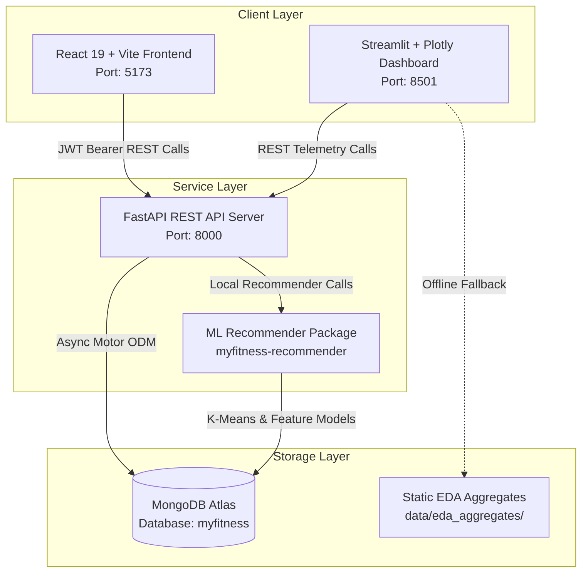

# 🏋️ Myfitness: Personalized Adaptive Fitness Platform

A production-grade, full-stack fitness and nutrition application featuring machine learning recommendation engines, biometric telemetry, goal tracking, and interactive population analytics.

---

## 🏛️ System Architecture



### Component Roles & Responsibilities
- **Frontend (`/frontend`)**: React 19 + Vite single-page application. Features accessible forms, client-side session auth, real-time catalog search, daily biometric logging, explainable recommendations, and weight trend forecasts.
- **Backend (`/backend`)**: Asynchronous FastAPI service on port 8000. Implements JWT authentication, Mifflin-St Jeor BMR/TDEE calculations, MET calorie burn summation, MongoDB schema validation, and REST routes.
- **ML Engine (`/ml`)**: K-Means clustering ($k=3$), hybrid Collaborative Filtering (Item-CF + TruncatedSVD Matrix Factorization + cluster priors), MET calorie allocations, and strict safety filters (100% vegetarian compliance and injury contraindication exclusions).
- **Dashboard (`/dashboard`)**: Streamlit + Plotly interactive analytics dashboard running in an isolated virtual environment (`dashboard/.venv`). Features per-user trajectory tracking, cluster scatters, and population distributions with automatic fallback to static aggregates.

---

## ⚙️ Environment Variables

Copy `.env.example` to `.env` in the repository root and configure your values:

| Variable | Description | Example / Default |
| :--- | :--- | :--- |
| `MONGODB_URI` | MongoDB Atlas or local connection string | `mongodb+srv://<user>:<password>@cluster.mongodb.net/?retryWrites=true&w=majority` |
| `MONGODB_DB_NAME` | Database name | `myfitness` |
| `SECRET_KEY` | Hex or secret key used for JWT signing | `change_this_to_a_secure_random_hex_string` |
| `ALGORITHM` | JWT cryptographic algorithm | `HS256` |
| `ACCESS_TOKEN_EXPIRE_MINUTES` | Token time-to-live in minutes | `1440` (24 hours) |
| `ENVIRONMENT` | Deployment environment | `development` |
| `DEBUG` | FastAPI debug mode | `True` |
| `API_V1_PREFIX` | Prefix for API router | `/api/v1` |
| `API_BASE_URL` | Base URL used by internal services | `http://localhost:8000/api/v1` |
| `VITE_API_BASE_URL` | Base API URL used by the frontend | `http://localhost:8000/api/v1` |
| `VITE_USE_MOCK` | Toggle mock API responses in frontend | `false` (set `true` for offline UI testing) |

---

## 🚀 Setup & Installation (Windows Guide)

### 1. Prerequisites
- **Python 3.11**: Make sure Python 3.11 is installed and available in your PATH.
- **Node.js 18+ / 20 LTS**: For frontend compilation and testing.
- **Git**: For version control.
- **MongoDB Atlas URI**: An active Atlas cluster connection string.

### 2. Backend & ML Environment Setup
Open PowerShell in the repository root:
```powershell
# 1. Create root virtual environment (Python 3.11)
python -m venv .venv

# 2. Activate virtual environment
.\.venv\Scripts\Activate.ps1

# 3. Upgrade pip and install wheel
python -m pip install --upgrade pip wheel

# 4. Install backend dependencies and editable ML package
pip install -r backend/requirements.txt
pip install -e ml/
pip install ruff pytest pytest-asyncio httpx
```

### 3. Database Seeding
With your `.env` configured with your `MONGODB_URI`:
```powershell
# Run idempotent database seed script
.\.venv\Scripts\python -m backend.app.db.seed
```
This script seeds:
- 60 exercises (`data/exercises.json`)
- 60 foods (`data/foods.json`)
- 1,200+ synthetic users, interaction logs, and daily tracking entries
- Creates text search indexes and unique compound constraints

### 4. Dashboard Isolated Environment Setup
Streamlit requires isolation to avoid version pinning collisions with FastAPI's `starlette`:
```powershell
# 1. Create dedicated dashboard virtual environment
python -m venv dashboard/.venv

# 2. Install dashboard dependencies
.\dashboard\.venv\Scripts\pip install --upgrade pip
.\dashboard\.venv\Scripts\pip install -r dashboard/requirements.txt
.\dashboard\.venv\Scripts\pip install pytest
```

### 5. Frontend Setup
```powershell
cd frontend
npm install
cd ..
```

---

## 🏃 Running the Applications

Open three separate terminal windows:

### Terminal 1: Backend API & Web Portal (Port 8000)
```powershell
.\.venv\Scripts\python -m uvicorn backend.app.main:app --host 127.0.0.1 --port 8000 --reload
```
- **Interactive Web Portal & Login**: [http://127.0.0.1:8000/login](http://127.0.0.1:8000/login) (Immediate standalone web app with profile editor, 5-star rating, Save All day completion, and recommendation preview)
- **Interactive API Swagger UI**: [http://127.0.0.1:8000/docs](http://127.0.0.1:8000/docs)
- **Alternative ReDoc**: [http://127.0.0.1:8000/redoc](http://127.0.0.1:8000/redoc)

### Terminal 2: React Frontend (Port 5173)
```powershell
cd frontend
npm run dev -- --host 127.0.0.1 --port 5173
```
- Web Application: [http://127.0.0.1:5173](http://127.0.0.1:5173)

### Terminal 3: Streamlit Analytics Dashboard (Port 8501)
```powershell
.\dashboard\.venv\Scripts\streamlit run dashboard/app.py --server.port 8501
```
- Dashboard UI: [http://127.0.0.1:8501](http://127.0.0.1:8501)

---

## 🧪 Running Tests & Quality Verification

Execute all test suites from the project root:

```powershell
# 1. Machine Learning Unit & Bonus Tests
.\.venv\Scripts\python -m pytest ml/tests

# 2. Backend Integration & Nutrition Tests
.\.venv\Scripts\python -m pytest backend/tests

# 3. Streamlit Dashboard Chart & Loader Tests
.\dashboard\.venv\Scripts\python -m pytest dashboard/tests

# 4. Frontend Vitest Tests & Production Build
cd frontend
npm test
npm run build
npm run lint
cd ..

# 5. Python Linting & Formatting Checks
.\.venv\Scripts\python -m ruff check .
.\.venv\Scripts\python -m ruff format --check .

# 6. Complete End-to-End Automated QA Walkthrough
.\.venv\Scripts\python scripts/e2e_smoke_qa.py
```

---

## 🔍 Troubleshooting

- **PowerShell Execution Policy**: If `Activate.ps1` gives a script execution policy error, run:
  ```powershell
  Set-ExecutionPolicy -Scope Process -ExecutionPolicy Bypass
  ```
- **Port Conflicts**:
  - If port 8000 is occupied: `netstat -ano | findstr :8000` and terminate the PID with `taskkill /PID <PID> /F`.
  - If port 5173 is occupied: Vite automatically defaults to 5174. Set `VITE_API_BASE_URL` in `frontend/.env`.
- **MongoDB Atlas Authentication Failure**:
  - If password contains special symbols (e.g. `@`, `:`, `/`), URL-encode them or use standard alphanumeric passwords.
  - Verify IP access list in MongoDB Atlas includes your current IP (`0.0.0.0/0` for development).
- **Starlette / Pydantic Version Conflicts**:
  - Never install `streamlit` into the root `.venv`. Keep it isolated in `dashboard/.venv`.

---

## ⚠️ Known Limitations

1. **Synthetic Data Characteristics**: User interactions and daily logs are generated synthetically using physiological distributions. While clusters reflect real archetypes (e.g., beginner weight loss, strength gain), offline recommendation recall is biased toward frequent global items.
2. **Approximate Nutrition & Burn Estimates**: Calorie burn uses Compendium MET multipliers which estimate population averages and do not account for individual basal metabolic efficiency, heart rate, or ambient temperature.
3. **Linear Weight Forecast**: Goal forecasting employs regularized linear regression over a 7-day minimum sliding window. It assumes linear caloric deficit behavior and does not account for metabolic adaptation plateaus.
